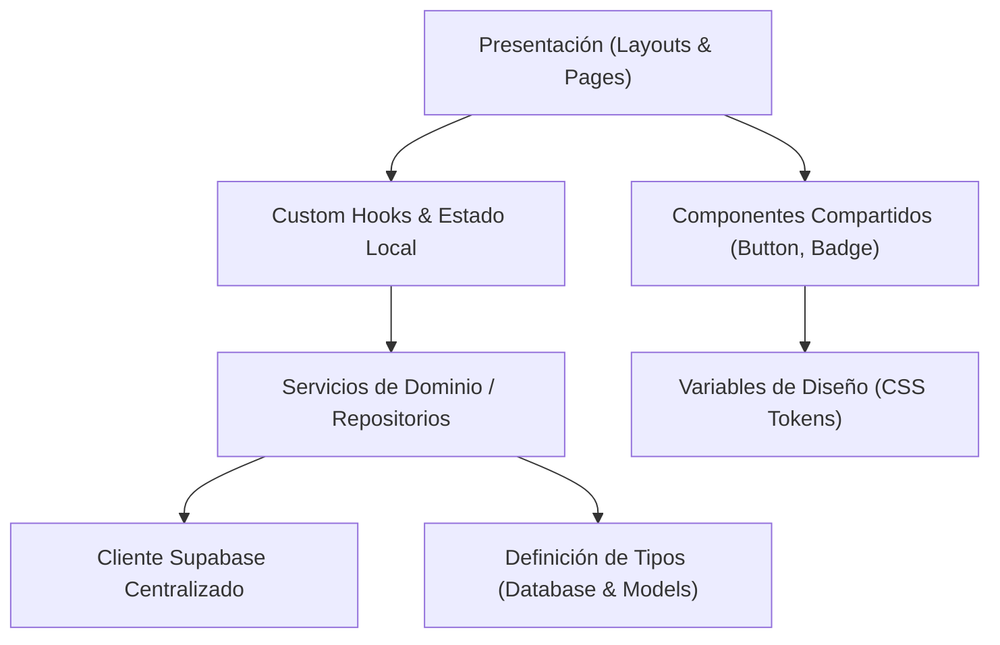
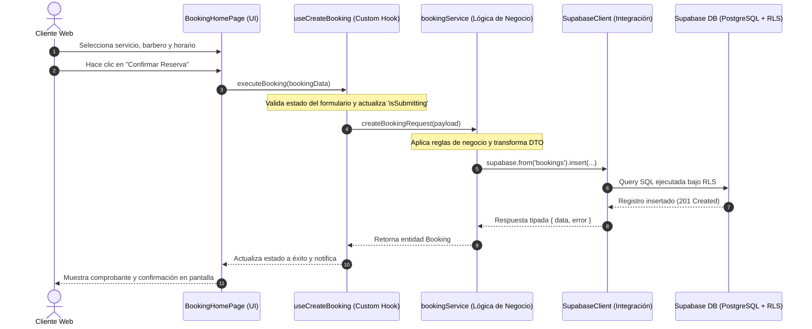

# Arquitectura del Sistema — Huomo

`features/branches` administra sucursales, pertenencia de empleados y tarifas por
ubicación; ver [modelo y flujo de configuración](branches.md).

El sitio público y el espacio administrativo ahora tienen layouts separados.
El hub de portales fue eliminado. Ver [dashboard y rutas actuales](admin-dashboard.md)
para la composición de sesión, shell y proveedor de datos del equipo.

`features/catalog` implementa el catálogo central y la asignación de servicios.
`features/employees` implementa la ficha e historial. Ambos reutilizan SaveForm
y las utilidades de FormData de `shared`; ver [catálogo](service-catalog.md).

Este documento detalla la estructura física y lógica del proyecto, los principios arquitectónicos aplicados, las dependencias permitidas entre capas y el recorrido de una operación típica en futuros sprints.

---

## 1. Principios de Diseño

1. **Separación Estricta de Responsabilidades**:
   - **Presentación (UI)**: Componentes visuales puros y layouts en `features/*/pages` y `shared/components`. Tienen prohibido comunicarse directamente con Supabase o ejecutar llamadas SQL/HTTP directas.
   - **Lógica de Negocio y Estado**: Custom hooks y servicios ubicados en carpetas de características (`features/*/hooks` o `features/*/services`).
   - **Acceso a Datos**: Centralizado en `integrations/supabase/client.ts` y repositorios dedicados por dominio.
2. **Desacoplamiento del Backend**:
   - La aplicación es capaz de inicializar, renderizar layouts y navegar rutas aun cuando las variables de Supabase no hayan sido configuradas en el entorno local.
3. **Tipado Estricto de Extremo a Extremo**:
   - Se prohíbe el uso de `any`. Toda entidad, parámetro y retorno de función debe contar con tipos explícitos o inferidos de forma segura.
4. **Escalabilidad por Dominio (Feature-First)**:
   - El código específico de una funcionalidad pertenece a su carpeta en `features/`, evitando dependencias cruzadas indebidas entre módulos independientes.

---

## 2. Estructura de Directorios

```text
Huomo/
├── docs/                         # Documentación técnica obligatoria en español
│   ├── architecture.md           # Estructura, responsabilidades y flujo de datos
│   ├── roles-and-portals.md      # Portales, roles y permisos pendientes
│   ├── development.md            # Convenciones, reglas de calidad y guía de desarrollo
│   ├── supabase.md               # Configuración de Supabase, migraciones y RLS
│   ├── deployment.md             # Despliegue en Vercel y reescritura de rutas SPA
│   ├── decisions.md              # Registro formal de decisiones técnicas (ADR)
│   └── sprint-0.md               # Estado, verificaciones, límites y próximos pasos
├── public/                       # Archivos estáticos públicos (favicon, etc.)
├── src/                          # Código fuente principal
│   ├── app/                      # Núcleo de la aplicación
│   │   ├── layouts/              # Shells visuales por contexto (Root, Admin, etc.)
│   │   ├── providers/            # Composición de contextos y proveedores globales
│   │   └── router/               # Enrutamiento centralizado y constantes de rutas
│   ├── features/                 # Módulos organizados por dominio funcional
│   │   ├── admin/                # Pantallas y lógica del portal de administración
│   │   ├── barber/               # Pantallas y lógica del portal de barbero
│   │   ├── booking/              # Pantallas y lógica del portal público de reservas
│   │   ├── staff/                # Equipo, datos y formularios de empleados
│   │   ├── notFound/             # Pantalla de error 404
│   │   └── reception/            # Pantallas y lógica del portal de recepción
│   ├── integrations/             # Adaptadores de servicios externos
│   │   └── supabase/             # Cliente de Supabase, tipos y helpers
│   ├── shared/                   # Componentes, librerías y tipos reutilizables
│   │   ├── components/           # Componentes visuales genéricos (Alert, Badge, Button)
│   │   ├── hooks/                # Custom hooks transversales (useSupabaseStatus)
│   │   ├── lib/                  # Utilidades puras y validación de entorno (env.ts)
│   │   └── types/                # Definiciones de tipos comunes (roles.ts)
│   ├── styles/                   # Sistema de diseño con CSS nativo y tokens
│   │   ├── index.css             # Reset, tipografía y utilidades globales
│   │   └── variables.css         # Tokens de color, espaciado y sombras
│   ├── test/                     # Configuración de pruebas y suites de verificación
│   ├── main.tsx                  # Punto de entrada de la aplicación React
│   └── vite-env.d.ts             # Tipos ambientales de Vite y matchers
├── supabase/                     # Configuración de base de datos y migraciones
│   ├── migrations/               # Archivos SQL versionados
│   └── README.md                 # Guía de migraciones y políticas RLS
├── .env.example                  # Plantilla de variables de entorno seguras
├── .gitignore                    # Reglas de exclusión de git y bloqueo de secretos
├── .prettierrc                   # Configuración del formateador Prettier
├── eslint.config.js              # Configuración de linter (ESLint v9 Flat Config)
├── index.html                    # Documento HTML principal con fuentes y metadatos
├── package.json                  # Dependencias y scripts del proyecto
├── tsconfig.app.json             # Configuración TypeScript estricta para el cliente
├── tsconfig.json                 # Referencia raíz de proyectos TypeScript
├── tsconfig.node.json            # Configuración TypeScript para herramientas Node
├── vercel.json                   # Configuración de despliegue y reescrituras SPA
├── vite.config.ts                # Configuración del empaquetador Vite
└── vitest.config.ts              # Configuración del entorno de pruebas unitarias
```

---

## 3. Matriz de Dependencias entre Capas



### Reglas de Dependencia

1. **Regla de oro**: `src/features/*/pages` **NUNCA** importa directamente `getSupabaseClient()` ni `@supabase/supabase-js`. Siempre se comunica mediante un hook o servicio de su propia funcionalidad.
2. `src/shared/components` no debe importar nada de `src/features`.
3. `src/integrations` no debe importar lógica de negocio ni componentes de `src/features`.

---

## 4. Recorrido de una Operación Futura (Ejemplo: Crear una Reserva)

Para comprender cómo interactuarán las capas cuando se implementen las funcionalidades de negocio en futuros sprints, se documenta el flujo de una operación típica:


